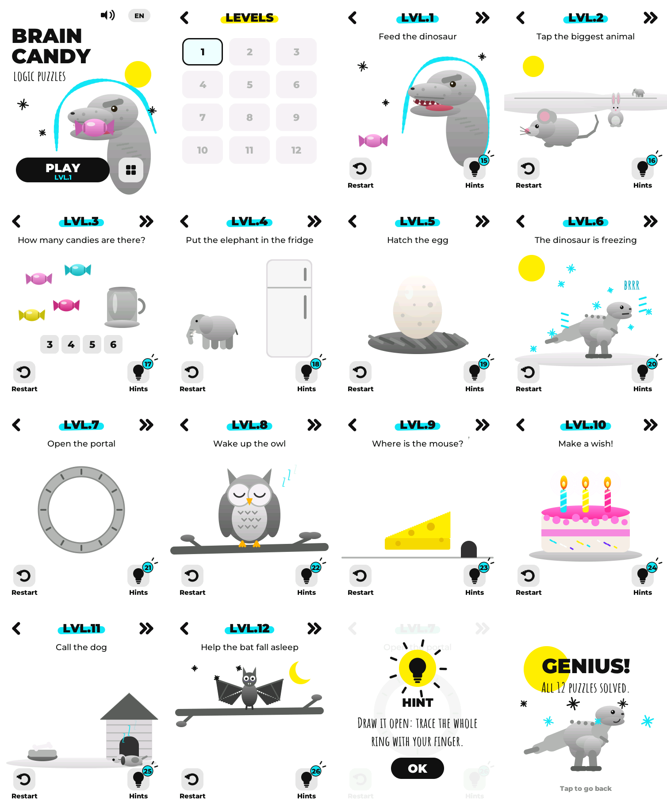

# puzzle-gadget: Brain Candy auf dem ESP32

Trickrätsel im Stil der iPhone-App **Brain Candy: Logic Puzzles** für das **Waveshare ESP32-S3-Touch-AMOLED-1.8 (V2)**. Der Look entspricht der App: weißer Grund, Figuren in Graustufen wie ausgeschnittene Fotos, knallige Akzente in Cyan, Gelb und Pink, fette Montserrat-Schrift, Zurufe in Handschrift. Oben steht „LVL.7“ mit Cyan-Marker, unten liegen die grauen Knöpfe „Restart“ und „Hints“ mit dem Zähler im Cyan-Kreis.



Englisch und Deutsch lassen sich auf dem Titelbild umschalten (EN/DE):


## Die Level

Zwölf eigene Trickrätsel. Die naheliegende Antwort ist selten die richtige, und jedes Level nutzt eine andere Fähigkeit des Geräts:

| LVL | Aufgabe | Lösung (Spoiler) |
|---|---|---|
| 1 | Füttere den Dino | Bonbon ins Maul ziehen |
| 2 | Tippe auf das größte Tier | der winzige Elefant am Horizont, nicht die riesige Maus vorne |
| 3 | Wie viele Bonbons? | Becher wegschieben, darunter liegt das fünfte |
| 4 | Elefant in den Kühlschrank | Tür auf, Elefant rein, Tür zu |
| 5 | Lass das Küken schlüpfen | Finger auf dem Ei liegen lassen (Wärme) |
| 6 | Dem Dino ist kalt | der gelbe „Deko“-Kreis ist die Sonne: zum Dino ziehen |
| 7 | Öffne das Portal | einmal mit dem Finger um den Ring fahren |
| 8 | Weck die Eule auf | Gerät schütteln (IMU) |
| 9 | Wo ist die Maus? | sie sitzt hinter dem Aufgabentext: Text wegziehen |
| 10 | Wünsch dir was! | Kerzen auspusten (Mikrofon) oder schnell drüberwischen |
| 11 | Ruf den Hund | auf den Tisch klopfen (IMU) oder rufen (Mikrofon) |
| 12 | Hilf der Fledermaus beim Einschlafen | Gerät auf den Kopf drehen oder sie unter den Ast hängen |

Tipps: Am Anfang gibt es 15, jedes erstmals gelöste Level bringt einen dazu. Ein Tipp kostet beim ersten Ansehen pro Level einen. Mit „>>“ lässt sich ein Level für 3 Tipps überspringen. Spielstand, Tipps, Sprache und Ton bleiben im NVS gespeichert.

Nach 90 s ohne Berührung wird das Display dunkler, nach 4 min geht es aus. Ein Tipp weckt es wieder (dieser erste Tipp zählt nicht als Spielzug).

## Bauen und flashen

PlatformIO (`pip install platformio`), Gerät per USB-C anstecken:

```bash
pio run -t upload
```

Die Plattform ist auf pioarduino `55.03.313` (Arduino-Core 3.3) festgelegt. Die aktuelle „stable“ bringt Core 4.0 mit, damit kompiliert GFX Library 1.6.8 nicht mehr.

Serielle Befehle (115200 Baud, `pio device monitor`):

| Befehl | Wirkung |
|---|---|
| `status` | Bildschirm, Level, gelöste Level, Tipps, Neigung, Mikrofonpegel |
| `level N` | Level N (1–12) starten |
| `tipp X Y`, `wisch X0 Y0 X1 Y1` | Berührung nachstellen |
| `klopf N` | N Schläge auf den Tisch nachstellen |
| `reset` | Spielstand löschen |
| `log` | fps und Rechenzeiten alle 2 s |

## Simulator

```bash
make -C sim && sim/bcsim --tour /tmp/bilder
```

`--tour` spielt jedes Level in beiden Sprachen auf seinem Lösungsweg durch (mit ein paar falschen Versuchen vorweg). Dabei prüft es, dass das Level gelöst wird, speichert Bilder (PPM) und meldet jeden Text, der über den Rand oder in die runden Display-Ecken ragt.

Mit Fenster (braucht SDL2, z. B. `brew install sdl2`): `make -C sim sdl && sim/bcsim`. Maus = Finger, X halten = schütteln, M halten = pusten/rufen, K = auf den Tisch klopfen, U halten = Gerät umdrehen, P = Bildschirmfoto.

## Aufbau

```
core/        Vektor-Renderer (368×448, kantengeglättet, bandweise), Schriften, Synthesizer, Klopf-/Schüttel-Erkennung
             (aus esp32-kids-adhs übernommen; neu: Hintergrundfarbe in Scene::bg)
game/        game.cpp: Titel, Levelauswahl, Kopfzeile, Tipps, Überspringen, Erfolgsbild, Energiesparen
             levels.cpp: die zwölf Level (je eine Klasse mit reset/tick/draw)
             art.cpp: Schnörkel, Funkeln, Symbole und die Figuren (Dino, Maus, Elefant, Eule, Fledermaus, Hund, Ei …)
firmware/    Gerät: Rendern auf Kern 1, Display/Eingabe/Audio/Mikrofon auf Kern 0
lib/amoled18 Board-Schicht: Display (CO5300), Touch (CST816), IMU (QMI8658), Audio (ES8311)
sim/         Simulator (Tour ohne Fenster, interaktiv mit SDL2)
tools/       mkfont.py (Schrift → Bitmap-Header, Pillow), mkfonts.sh, fonts/
```

Ein neues Level ist eine Klasse in `game/levels.cpp`: `task()` und `hint()` (EN/DE), `reset()`, `tick()` bekommt pro Frame Finger, Neigung, Schütteln, Klopfen und Mikrofonpegel, `draw()` zeichnet. `h.solve()` meldet die Lösung, `h.nope()` und `h.say()` zeigen Zurufe. Dann `LEVELS` in `game/ui.h` hochzählen, `makeLevel()` ergänzen und in `sim/main.cpp` den Lösungsweg für die Tour eintragen.

Schriften neu erzeugen: `tools/mkfonts.sh` (braucht Pillow).

## Lizenzen

- Schriften: Montserrat und Amatic SC, SIL Open Font License 1.1, siehe [licenses/](licenses/). Die Bitmap-Fassungen in `core/font_*.h` sind daraus abgeleitet.
- ES8311-Treiber (`lib/amoled18/es8311*`): Espressif, Apache-2.0.
