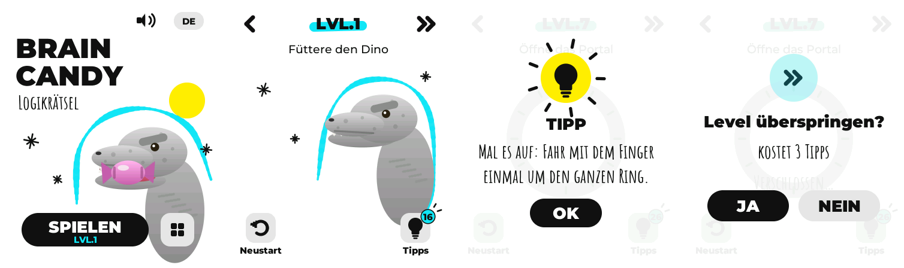

# puzzle-gadget: Brain Candy auf dem ESP32

Trickrätsel im Stil der iPhone-App **Brain Candy: Logic Puzzles** für das **Waveshare ESP32-S3-Touch-AMOLED-1.8 (V2)** und das **ESP32-S3-Touch-AMOLED-2.16**. Der Look entspricht der App: weißer Grund, Figuren in Graustufen wie ausgeschnittene Fotos, knallige Akzente in Cyan, Gelb und Pink, fette Montserrat-Schrift, Zurufe in Handschrift. Oben steht „LVL.7“ mit Cyan-Marker, unten liegen die grauen Knöpfe „Restart“ und „Hints“ mit dem Zähler im Cyan-Kreis.


Englisch und Deutsch lassen sich auf dem Titelbild umschalten (EN/DE):



## Die Level

36 Rätsel für Erwachsene. Level 1–12 sind Trickrätsel, die die Fähigkeiten des Geräts nutzen. Level 13–36 sind harte Denkaufgaben: Denkfallen, Logik, Kopfrechnen, Gedächtnis und Geschick. Zahlenantworten kommen über eine Tastatur. Jede falsche Antwort sperrt die Eingabe länger (4 s, 8 s, 16 s, höchstens 30 s), damit sich Durchprobieren nicht lohnt.

| LVL | Aufgabe | Lösung (Spoiler) |
|---|---|---|
| 1 | Füttere den Dino | erst auspacken (schnell über das Bonbon wischen), dann ins Maul ziehen |
| 2 | Tippe auf das größte Tier | der winzige Elefant am Horizont, nicht die riesige Maus vorne |
| 3 | Wie viele Bonbons? | Becher wegschieben, darunter liegen zwei: 6 |
| 4 | Elefant in den Kühlschrank | Tür auf, Elefant rein, Tür zu |
| 5 | Lass das Küken schlüpfen | Finger lange auf dem Ei liegen lassen (Wärme, ohne Fortschrittsanzeige) |
| 6 | Dem Dino ist kalt | der gelbe „Deko“-Kreis ist die Sonne: zum Dino ziehen |
| 7 | Öffne das Portal | einmal mit dem Finger um den Ring fahren |
| 8 | Weck die Eule auf | Gerät schütteln (IMU) |
| 9 | Wo ist die Maus? | sie sitzt hinter dem Aufgabentext: Text wegziehen |
| 10 | Wünsch dir was! | Kerzen auspusten (Mikrofon) oder schnell drüberwischen |
| 11 | Ruf den Hund | auf den Tisch klopfen (IMU) oder rufen (Mikrofon) |
| 12 | Hilf der Fledermaus beim Einschlafen | Gerät auf den Kopf drehen oder sie unter den Ast hängen |
| 13 | Schläger und Ball kosten 1,10 € | 5 Cent |
| 14 | 5 Maschinen, 5 Minuten, 5 Teile | 5 Minuten |
| 15 | Seerosen verdoppeln sich, 48 Tage | 47 |
| 16 | Stroop-Sprint | 10 Schriftfarben in Folge in 12 s tippen |
| 17 | 10 schwarze, 10 weiße Socken im Dunkeln | 12 |
| 18 | Merk dir die Zahl (7 Ziffern, 2 s) | jedes Mal eine neue Zahl |
| 19 | 60 km hin mit 30, zurück mit 90 km/h | 45 km/h |
| 20 | Drei falsch beschriftete Kisten | aus GEMISCHT ziehen |
| 21 | Vater viermal so alt, in 20 Jahren doppelt | 40 |
| 22 | Kettenrechnung im Kopf | 7 × 6 – 9 : 3 + 15 × 2 = 52 |
| 23 | Kugel-Labyrinth | Gerät kippen, Löcher meiden (IMU) |
| 24 | Ritter und Schurken | 1 (A Schurke, B Ritter) |
| 25 | 1 kg Gurken, 99 % → 98 % Wasser | 500 g |
| 26 | Mittwoch + 100 Tage | 5 (Freitag) |
| 27 | Farbfolge nachtippen | 7 Farben merken |
| 28 | Schnecke im 10-m-Brunnen | Tag 8 |
| 29 | Welche Zahl fehlt? | 6 (magisches Quadrat) |
| 30 | Ziffer 1 von 1 bis 100 | 21 |
| 31 | Ziegenproblem | 67 % |
| 32 | Quadrate auf dem Schachbrett | 204 |
| 33 | Seil um den Äquator + 1 m | 16 cm |
| 34 | Zeiger übereinander zwischen 12 und 24 Uhr | 10 |
| 35 | Buchstaben der Antwort auf diese Frage | 4 („vier“) |
| 36 | 1, 11, 21, 1211, 111221, ? | 312211 |

Tipps: Am Anfang gibt es 15, jedes erstmals gelöste Level bringt einen dazu. Ein Tipp kostet beim ersten Ansehen pro Level einen. Mit „>>“ lässt sich ein Level für 3 Tipps überspringen. Spielstand, Tipps, Sprache, Lautstärke, Schwierigkeit und Bestzeiten bleiben im NVS gespeichert.

**Schwierigkeit** (Knopf auf dem Titelbild):

| Stufe | Regeln |
|---|---|
| Leicht | Tipps kostenlos, nach 30 s erscheint der Tipp von selbst, Überspringen kostet 1 Tipp, die Aufgabenkarte zeigt, was helfen könnte (Finger, schütteln, kippen …) |
| Normal | wie oben beschrieben |
| Schwer | keine Tipps, kein Überspringen, Stoppuhr mit Bestzeit pro Level |

**Intro und Aufgabenkarte**: Beim ersten Start erklären drei Karten das Spiel (wieder aufrufbar mit „?“ auf dem Titelbild). Vor jedem Level zeigt eine Karte die Aufgabe groß, mit „LOS!“ geht es los.

**Ton und Sprache**: Das Lautsprecher-Symbol schaltet durch vier Stufen (aus, leise, mittel, laut). Das Gerät liest die Aufgabe auf der Karte vor und ruft beim Lösen „Bravo!“ & Co. Die Clips sind mit Tobias' HeyGen-Stimmklon gesprochen (`tools/mkvoice.py`); solange das Gerät spricht, wird das Mikrofon ignoriert.

Nach 90 s ohne Berührung wird das Display dunkler, nach 4 min geht es aus. Ein Tipp weckt es wieder (dieser erste Tipp zählt nicht als Spielzug).

**Tasten (AMOLED-2.16):**

| Taste | Wirkung |
|---|---|
| Power kurz | Display aus/an (das Spiel pausiert, Touch wird ignoriert) |
| Power lang (ca. 1,5 s) | Gerät ausschalten; einschalten wieder mit der Power-Taste (nach 6 s schaltet der Power-Chip notfalls selbst ab) |
| Taste an GPIO18 | Display aus/an |
| BOOT | bleibt frei (zum Flashen) |

## Bauen und flashen

PlatformIO (`pip install platformio`), Gerät per USB-C anstecken:

```bash
pio run -t upload
```

Für das **Waveshare ESP32-S3-Touch-AMOLED-2.16** (480×480, Touch CST9220, Mikrofone am ES7210) gibt es eine eigene Umgebung. Das Spiel liegt dort mittig mit weißem Rand:

```bash
pio run -e amoled216 -t upload
```

Die Plattform ist auf pioarduino `55.03.313` (Arduino-Core 3.3) festgelegt. Die aktuelle „stable“ bringt Core 4.0 mit, damit kompiliert GFX Library 1.6.8 nicht mehr.

Serielle Befehle (115200 Baud, `pio device monitor`):

| Befehl | Wirkung |
|---|---|
| `status` | Bildschirm, Level, gelöste Level, Tipps, Neigung, Mikrofonpegel |
| `level N` | Level N (1–36) starten |
| `stufe N` | Schwierigkeit: 0 leicht, 1 normal, 2 schwer |
| `sag KEY` | Sprach-Clip abspielen, z. B. `sag de_t05` |
| `tipp X Y`, `wisch X0 Y0 X1 Y1` | Berührung nachstellen |
| `klopf N` | N Schläge auf den Tisch nachstellen |
| `reset` | Spielstand löschen |
| `log` | fps und Rechenzeiten alle 2 s |

## Simulator

```bash
make -C sim && sim/bcsim --tour /tmp/bilder
```

`--tour` spielt jedes Level in beiden Sprachen auf seinem Lösungsweg durch (mit ein paar falschen Versuchen vorweg). Dabei prüft es, dass das Level gelöst wird, speichert Bilder (PPM) und meldet jeden Text, der über den Rand oder in die runden Display-Ecken ragt.

Mit Fenster (braucht SDL2, z. B. `brew install sdl2`): `make -C sim sdl && sim/bcsim`. Maus = Finger, X halten = schütteln, M halten = pusten/rufen, K = auf den Tisch klopfen, U halten = Gerät umdrehen, P = Bildschirmfoto.

## Aufbau

```
core/        Vektor-Renderer (368×448, kantengeglättet, bandweise), Schriften, Synthesizer, Klopf-/Schüttel-Erkennung
             (aus esp32-kids-adhs übernommen; neu: Hintergrundfarbe in Scene::bg)
game/        game.cpp: Intro, Titel, Levelauswahl, Aufgabenkarte, Kopfzeile, Tipps, Überspringen, Schwierigkeit, Erfolgsbild, Energiesparen
             levels.cpp: die 36 Level (je eine Klasse mit reset/tick/draw; Denkfragen über Quiz + QuizSpec, Zahlentastatur NumPad mit Sperre Lock)
             art.cpp: Schnörkel, Funkeln, Symbole und die Figuren (Dino, Maus, Elefant, Eule, Fledermaus, Hund, Ei …)
firmware/    Gerät: Rendern auf Kern 1, Display/Eingabe/Audio/Mikrofon auf Kern 0; voice.bin + voice_index.h (Sprach-Clips)
lib/amoled18 Board-Schicht: Display (CO5300), Touch (CST816 bzw. CST9220 auf dem 2.16), IMU (QMI8658), Audio (ES8311, Mikrofone am ES7210 auf dem 2.16)
sim/         Simulator (Tour ohne Fenster, interaktiv mit SDL2)
tools/       mkfont.py (Schrift → Bitmap-Header, Pillow), mkfonts.sh, fonts/, mkvoice.py (Sprach-Clips über HeyGen oder macOS say)
```

Ein neues Level ist eine Klasse in `game/levels.cpp`: `task()` und `hint()` (EN/DE), `reset()`, `tick()` bekommt pro Frame Finger, Neigung, Schütteln, Klopfen und Mikrofonpegel, `draw()` zeichnet. `h.solve()` meldet die Lösung, `h.nope()` und `h.say()` zeigen Zurufe. Dann `LEVELS` in `game/ui.h` hochzählen, `makeLevel()` ergänzen und in `sim/main.cpp` den Lösungsweg für die Tour eintragen.

Schriften neu erzeugen: `tools/mkfonts.sh` (braucht Pillow). Sprach-Clips neu erzeugen (nach geänderten Aufgabentexten): `make -C sim && HEYGEN_API_KEY=… python3 tools/mkvoice.py` (HeyGen, Modell `heygen-voice-1-turbo-free`, Stimme über `HEYGEN_VOICE_ID`) oder ohne Schlüssel `python3 tools/mkvoice.py --say` (macOS-Stimmen).

## Lizenzen

- Schriften: Montserrat und Amatic SC, SIL Open Font License 1.1, siehe [licenses/](licenses/). Die Bitmap-Fassungen in `core/font_*.h` sind daraus abgeleitet.
- ES8311-Treiber (`lib/amoled18/es8311*`): Espressif, Apache-2.0.
- ES7210-Treiber (`lib/amoled18/es7210*`, `audio_hal.h`): Espressif MIT License, aus den Waveshare-Beispielen zum AMOLED-2.16.
- Sprach-Clips (`firmware/voice.bin`): Tobias' eigene Stimme (HeyGen-Stimmklon „tobias_pitch“).
